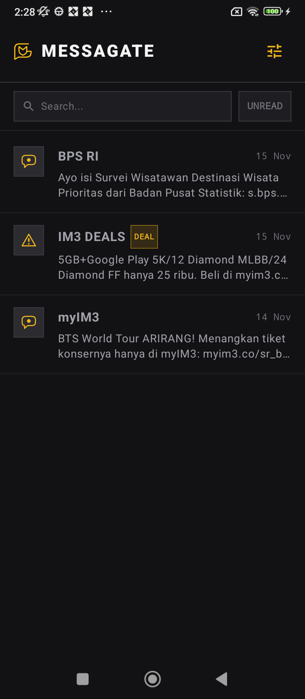
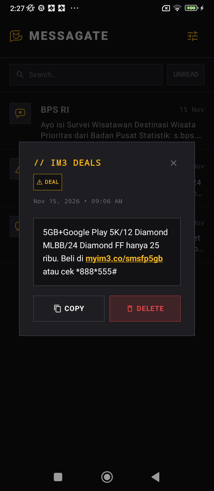

# Messagate 👁️🛡️

**A fork of [Heimdall](https://github.com/monkeyscript/heimdall) — an offline, pre-storage SMS spam firewall — rebuilt around a fully user-editable detection engine.**

[](https://github.com/karjok/heimdall/releases/latest)
[]()
[](LICENSE)

<p align="center">
  
  
</p>

> **Fork credit:** Messagate is forked from **Heimdall** by [monkeyscript](https://github.com/monkeyscript/heimdall).
> All credit for the original idea, pre-storage interception design, OTP helper, category heuristics
> and the base UI goes to the Heimdall author. This fork is maintained by
> [Karjok Pangesty](https://github.com/karjok) and is licensed under Apache-2.0, same as upstream.

---

## 🎭 How It Works

Most spam blockers move spam into a folder — it still lives in your phone's SMS database, shows up if you switch messaging apps, and gets backed up to the cloud.

Messagate drops spam **before it is ever saved**. When an incoming SMS matches a rule, it is silently discarded: no notification, no vibration, and it **never touches the system SMS database**. Clean messages are written to the Telephony provider and notified as usual. If you switch back to Google Messages, your inbox is already clean.

---

## 🆕 What This Fork Adds

The upstream project is a solid keyword blocker. This fork keeps the interception model and privacy guarantees, and replaces the fixed keyword logic with a small, deterministic rule engine plus the tooling around it.

| Capability | Heimdall (upstream) | Messagate (this fork) |
| :--- | :---: | :---: |
| Pre-storage spam drop | ✅ | ✅ |
| Zero internet / no telemetry | ✅ | ✅ |
| Rule matching | Keyword contains | **CONTAINS / WORD / PREFIX / SUFFIX / EXACT / REGEX** |
| Match target | Message body | **Body, sender ID, or both** |
| Rule actions | Block | **BLOCK / ALLOW / TAG / MUTE** |
| Rule order & precedence | — | **Priority list, first match wins, ALLOW always first** |
| Rule tester | — | **Live test bench inside the editor** |
| Quick block | — | **One field: TEXT or REGEX, matches sender + body** |
| Backup / restore | — | **Rules + switches as JSON (SAF file picker)** |
| Multi-select delete | Inbox | **Inbox (whole row) + Detection Rules list** |
| Distribution | F-Droid | **GitHub Releases only** |
| App id | `com.heimdall.app` | `com.messagate.app` |

### Highlights

- **Ordered detection engine** — rules evaluate top to bottom; each can stop processing. `ALLOW` rules run in a first pass, so a trusted sender can never be blocked by a broad regex. Regex compilation is validated in the editor, capped in length, and bounded by a 40 ms evaluation budget so a bad pattern cannot stall SMS delivery.
- **Anti-evasion normalization** — one shared normalizer (zero-width/format characters stripped, locale-safe lowercase, 4 KB cap) is used by live SMS, inbox import and re-evaluation, so verdicts never diverge between paths.
- **Quick Block** — Settings → Quick Block: type a word or flip to REGEX; it matches the **sender ID or body** and is inserted at the top of the rule list. Every rule — quick, migrated keyword, or engine-made — appears there as a deletable chip.
- **Detection Rules screen** — drag-free ordering (move up/down), enable/disable, per-rule action and category, live test bench, JSON import/export, long-press multi-select delete.
- **Backup / Restore** — export rules and switches to `messagate-backup-YYYY-MM-DD.json` and import them on another device. Message contents are never included.
- **Rebrand & UI polish** — monoline G+M logo (with a padded Android 12 splash icon), vector icons for every category and the spam warning flag, compact message header (`⚠ pattern` instead of two chips), yellow text cursors, consistent destructive button styling, fixed label wrapping.
- **Legacy keyword migration** — existing keyword lists are converted to `BLOCK` rules on first run; nothing is lost.
- **Hidden easter egg** — long-press the logo. That's all we're saying.

Roadmap: user-defined categories (add/rename/recolor/reorder), category filters in the inbox, saved views, and undo for bulk deletes. See [`docs/customization-plan.md`](docs/customization-plan.md).

---

## 📦 Installation

Releases are published **only on GitHub** (this fork is not on F-Droid):

➡️ **[Download the latest APK](https://github.com/karjok/heimdall/releases/latest)**

- **New app id:** Messagate installs as `com.messagate.app`, so it does **not** replace an existing Heimdall install and cannot import its data. Uninstall the upstream app to avoid duplicate notifications from its `SMS_RECEIVED` receiver.
- Requires Android 8.0+ (API 26). Tested on Android 13.
- Automatic updates: add `https://github.com/karjok/heimdall` to [Obtainium](https://github.com/ImranR98/Obtainium).
- Sideloading, Play Protect and restricted-permission help: [`docs/installation.md`](docs/installation.md).

After launching, grant the default-SMS role (required for pre-storage blocking) and notification permission.

---

## 🛠️ Build From Source

### Requirements

| Tool | Version |
| :--- | :--- |
| JDK | 17 or newer (tested with 21) |
| Android SDK | Platform 34 + Build-Tools 34.0.0 |
| Gradle | included via `./gradlew` (8.9) |
| Kotlin / AGP | 2.0.0 / 8.5.2 |

### 1. Clone and configure the SDK

```bash
git clone https://github.com/karjok/heimdall.git
cd heimdall

# Point Gradle at your Android SDK (or export ANDROID_HOME instead)
printf 'sdk.dir=%s\n' "$HOME/Android/Sdk" > local.properties
```

`local.properties` is git-ignored. Android Studio users can just open the project and let it generate the file.

### 2. Run the tests and build a debug APK

```bash
# 14 unit tests for the rule engine (JVM, no device needed)
./gradlew testDebugUnitTest

# Debug build → app/build/outputs/apk/debug/app-debug.apk
./gradlew assembleDebug

# Install on a connected device
adb install -r app/build/outputs/apk/debug/app-debug.apk
```

### 3. Build a signed release

Release signing is configured through environment variables — never commit a keystore.

```bash
# Place the keystore in the repository root as messagate-release.jks
# (heimdall-release.jks is accepted as a fallback)

export KEYSTORE_PASSWORD='…'
export KEY_PASSWORD='…'
export KEY_ALIAS='messagate'      # default

./gradlew assembleRelease
# → app/build/outputs/apk/release/Messagate-v1.1.0.apk
```

If the keystore or passwords are missing, Gradle still builds an unsigned release.

### 4. Automated release (GitHub Actions)

[`.github/workflows/release.yml`](.github/workflows/release.yml) builds and publishes the APK when a `v*` tag is pushed. Required repository secrets:

- `KEYSTORE_BASE64` — base64 of `messagate-release.jks`
- `KEYSTORE_PASSWORD`
- `KEY_PASSWORD`
- `KEY_ALIAS`

```bash
git tag v1.1.0
git push origin v1.1.0
```

---

## 🗂️ Project Layout

```
app/src/main/java/com/messagate/app/
├── core/engine/        ordered rule engine, compiler, JSON repository, migration
├── data/               message log, prefs, backup/restore, prefs rename migration
├── receiver/           SMS/MMS receivers, OTP copy receiver
├── service/            headless SMS send service (default-SMS eligibility)
├── ui/settings/        rules screen, editor, backup launchers
├── util/               normalizer, OTP, category heuristics, linkify, notifications
└── MainActivity.kt     inbox, detail modal, settings
app/src/test/           JVM tests for the rule engine
docs/                   features, installation, customization plan
```

Detection flow: `SmsReceiver` → `DetectionService` (engine) → `PreferencesManager` log → Telephony provider (clean only) + notification. The same engine classifies imported and re-evaluated messages.

---

## 🔒 Privacy

- **No `INTERNET` permission** — the APK cannot reach the network.
- No analytics, accounts, ads or cloud sync.
- All rules, logs and backups stay on the device; backups are written only where you choose in the system file picker.
- Messages classified as spam are withheld from Android's SMS database by design.

---

## 🙏 Credits & License

- **Original project:** [Heimdall](https://github.com/monkeyscript/heimdall) by **monkeyscript** — interception architecture, OTP extraction, category heuristics, base UI and the original documentation.
- **This fork:** maintained by **Karjok Pangesty** ([@karjok](https://github.com/karjok)).
- **License:** [Apache License 2.0](LICENSE). The original copyright notice (`Copyright 2026 monkeyscript`) is retained; modifications are released under the same license.
- Vector icons, monoline logo and splash artwork are part of this fork.

If you find a bug or have a feature request for the fork, please [open an issue](https://github.com/karjok/heimdall/issues). For the original app, use the [upstream tracker](https://github.com/monkeyscript/heimdall/issues).
